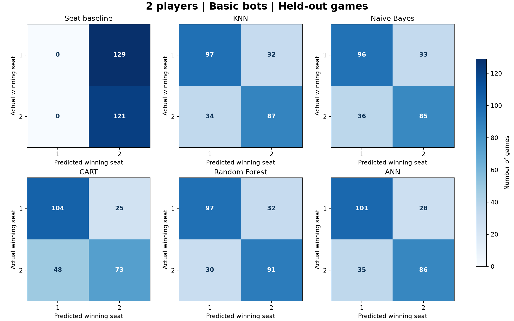
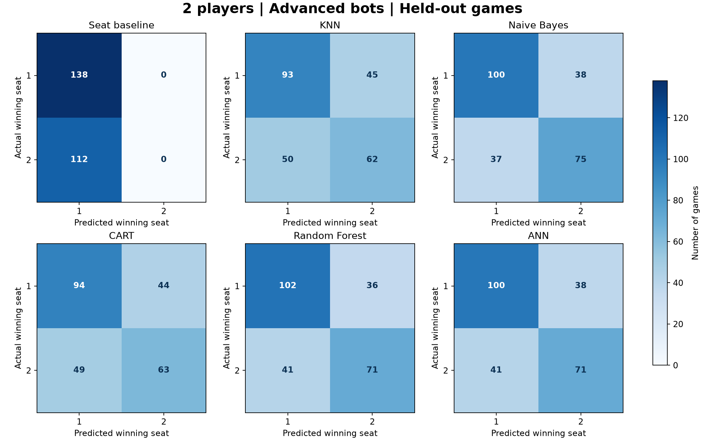
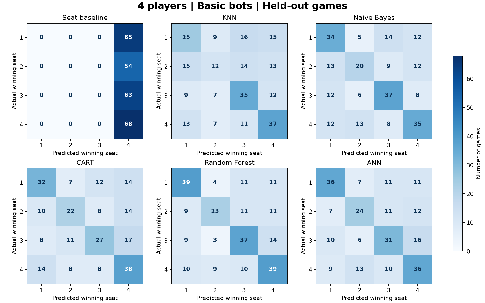
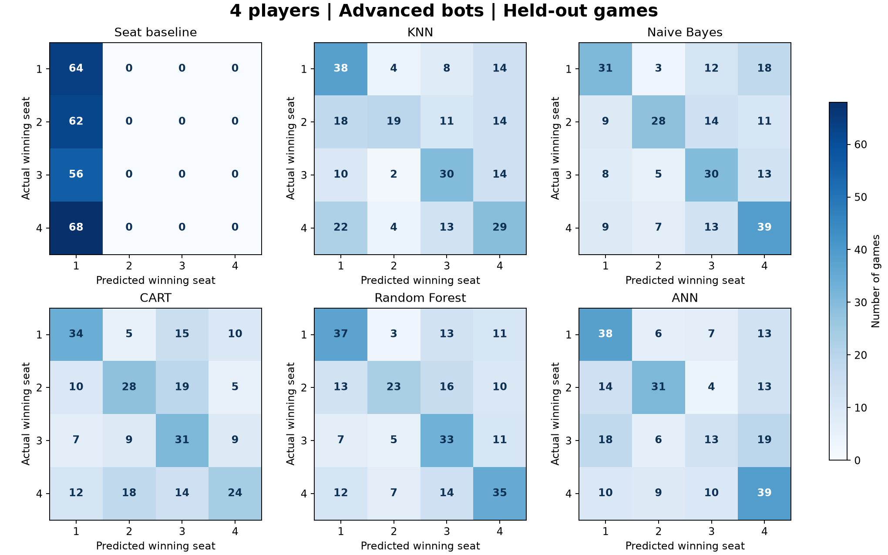

# Catan winner prediction

## Can we predict the winner before the first roll?

Catanatron ran **4,000 games**, with **1,000 attempts in each scenario**. The engine returned a winner in **4,000 games**. The predictors describe the visible opening after every seat placed two settlements and two roads, immediately before the first roll. The target is the eventual winning seat.

**18 of 20 classifier comparisons** showed a statistically reliable improvement over the seat-only baseline after correction for multiple comparisons.

### Best observed classifier per scenario

| Scenario | Test games | Best classifier | Accuracy | Seat baseline | Lift | Macro F1 |
|---|---:|---|---:|---:|---:|---:|
| 2 players, Basic | 250 | Random Forest | 75.2% | 48.4% | +26.8 pp | 0.752 |
| 2 players, Advanced | 250 | Naive Bayes | 70.0% | 55.2% | +14.8 pp | 0.697 |
| 4 players, Basic | 250 | Random Forest | 55.2% | 27.2% | +28.0 pp | 0.548 |
| 4 players, Advanced | 250 | Naive Bayes | 51.2% | 25.6% | +25.6 pp | 0.512 |

The best observed model was selected descriptively from the same held-out results shown here. Uniform guesses have expected accuracy of 50% with two seats and 25% with four. The seat-only baseline always predicts the seat with the most training wins.

### Test-set accuracy and classification reports

| Scenario | Model | Accuracy | Macro precision | Macro recall | Macro F1 |
|---|---|---:|---:|---:|---:|
| 2 players, Basic | Seat baseline | 48.4% | 0.242 | 0.500 | 0.326 |
| 2 players, Basic | KNN | 73.6% | 0.736 | 0.735 | 0.736 |
| 2 players, Basic | Naive Bayes | 72.4% | 0.724 | 0.723 | 0.723 |
| 2 players, Basic | CART | 70.8% | 0.715 | 0.705 | 0.703 |
| 2 players, Basic | Random Forest | 75.2% | 0.752 | 0.752 | 0.752 |
| 2 players, Basic | ANN | 74.8% | 0.749 | 0.747 | 0.747 |
| 2 players, Advanced | Seat baseline | 55.2% | 0.276 | 0.500 | 0.356 |
| 2 players, Advanced | KNN | 62.0% | 0.615 | 0.614 | 0.614 |
| 2 players, Advanced | Naive Bayes | 70.0% | 0.697 | 0.697 | 0.697 |
| 2 players, Advanced | CART | 62.8% | 0.623 | 0.622 | 0.622 |
| 2 players, Advanced | Random Forest | 69.2% | 0.688 | 0.687 | 0.687 |
| 2 players, Advanced | ANN | 68.4% | 0.680 | 0.679 | 0.680 |
| 4 players, Basic | Seat baseline | 27.2% | 0.068 | 0.250 | 0.107 |
| 4 players, Basic | KNN | 43.6% | 0.422 | 0.427 | 0.419 |
| 4 players, Basic | Naive Bayes | 50.4% | 0.500 | 0.499 | 0.498 |
| 4 players, Basic | CART | 47.6% | 0.477 | 0.472 | 0.472 |
| 4 players, Basic | Random Forest | 55.2% | 0.557 | 0.547 | 0.548 |
| 4 players, Basic | ANN | 50.8% | 0.508 | 0.505 | 0.506 |
| 4 players, Advanced | Seat baseline | 25.6% | 0.064 | 0.250 | 0.102 |
| 4 players, Advanced | KNN | 46.4% | 0.495 | 0.466 | 0.461 |
| 4 players, Advanced | Naive Bayes | 51.2% | 0.528 | 0.511 | 0.512 |
| 4 players, Advanced | CART | 46.8% | 0.475 | 0.472 | 0.467 |
| 4 players, Advanced | Random Forest | 51.2% | 0.525 | 0.513 | 0.509 |
| 4 players, Advanced | ANN | 48.4% | 0.479 | 0.475 | 0.468 |

The [complete classification reports](classification_report.csv) include precision, recall, F1, and support for each winning seat, plus macro and weighted averages. A metric with a zero denominator is recorded as zero. The [model metrics](model_metrics.csv) and [test predictions](test_predictions.csv) provide the underlying comparisons.

### Confusion matrices

Rows show the actual winning seat, columns show the predicted winning seat, and diagonal cells count correct predictions. The color scale is shared within each scenario.

## Is there a universally good starting position?

A starting-position rule selects the seat with the highest value of a fixed opening feature. For this experiment, the rule must outperform the seat-only baseline in all four scenarios after correcting for 28 comparisons. This is an operational definition of robustness across the tested settings.

**None of the seven rules met that criterion.**
The balanced score improved on the baseline in 4 of 4 test samples and cleared the adjusted significance threshold in 3. This experiment covers two post-setup bot policies and one opening-placement policy.

| Opening rule | 2P Basic | 2P Advanced | 4P Basic | 4P Advanced |
|---|---:|---:|---:|---:|
| Production | +22.8 pp * | +11.6 pp | +17.2 pp * | +21.2 pp * |
| Diversity | +20.8 pp * | +4.8 pp | +16.8 pp * | +17.6 pp * |
| Road Materials | +8.4 pp | -2.0 pp | +5.2 pp | +17.6 pp * |
| City Materials | +12.4 pp | +2.8 pp | +21.2 pp * | +14.0 pp * |
| Expansion | +2.4 pp | -4.0 pp | +0.8 pp | +8.8 pp |
| Port Fit | -3.6 pp | -12.4 pp | -4.0 pp | +0.4 pp |
| Balanced | +27.2 pp * | +12.8 pp | +26.8 pp * | +28.0 pp * |

Values are accuracy differences from the seat-only baseline in percentage points. An asterisk marks a positive difference with adjusted p < 0.05. See [opening rule results](opening_rule_results.csv) for paired intervals and adjusted p-values.

### Cross-tier transfer

For each player count, a Random Forest trained on one tier predicts winners in the other tier on seeds excluded from training. This measures whether learned relationships transfer between the two policies when the opening setup process is held constant.

| Players | Train tier | Test tier | Test games | Accuracy | Seat baseline | Lift |
|---:|---|---|---:|---:|---:|---:|
| 2 | Advanced | Basic | 250 | 72.8% | 48.4% | +24.4 pp |
| 2 | Basic | Advanced | 250 | 66.8% | 55.2% | +11.6 pp |
| 4 | Advanced | Basic | 250 | 55.2% | 27.2% | +28.0 pp |
| 4 | Basic | Advanced | 250 | 45.2% | 25.6% | +19.6 pp |

[Cross-tier results](cross_tier_results.csv) include paired intervals. Transfer is descriptive.

## Experimental design

- **Basic** uses Catanatron Weighted Random. **Advanced** uses Catanatron Value Function, a greedy heuristic with 5% random exploration at decisions with multiple choices.
- The two tiers share the same starting positions within each player count and seed. A common opening policy favors productive, diverse intersections probabilistically and picks a legal starting road at random. The match compares post-setup bot policies and does not estimate the effect of differences in their own placement choices.
- Catanatron uses its default board and ten victory points. The two-player scenario uses the engine's standard mechanics with two seats. The source population is simulated games.
- The experiment reserves the same 25% of unique seeds in all scenarios. Every completed game contributes one example to its own scenario model. Games reaching the turn limit without a winner are counted and excluded from classification. See [game counts](game_counts.csv).
- Hyperparameters were fixed before the full evaluation. Models use ordered seat-level opening features, with identifiers, node IDs, the RNG seed, and post-roll outcomes excluded. The KNN and ANN scalers are fit on training games.
- Differences are paired within game. Lift intervals are 95% game-level bootstrap intervals. Tests use exact McNemar p-values and Bonferroni correction separately for the 20 classifier comparisons and the 28 opening-rule comparisons.
- A high-scoring position can still lose. Opening features and winner associations are observational within this setup policy. The project does not estimate causal effects of moving a settlement or guarantee performance against humans.

See the [project README](../README.md) for the run commands and feature definitions.
